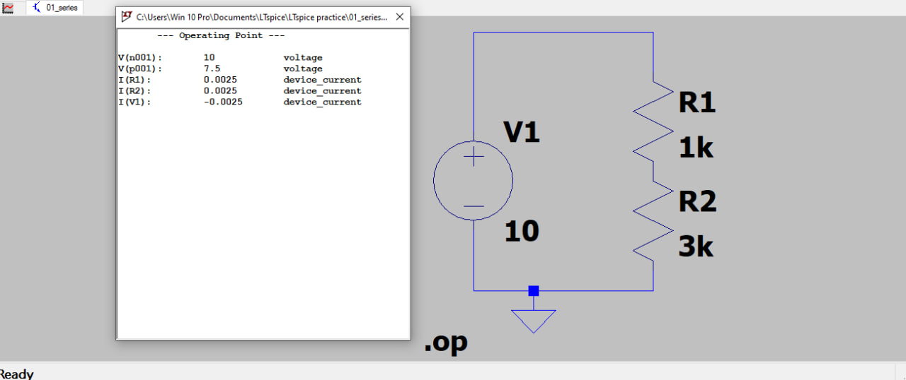
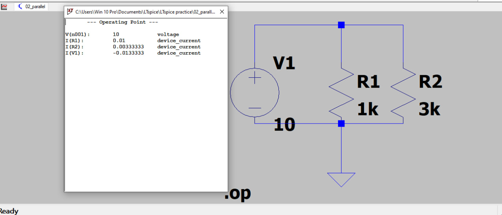
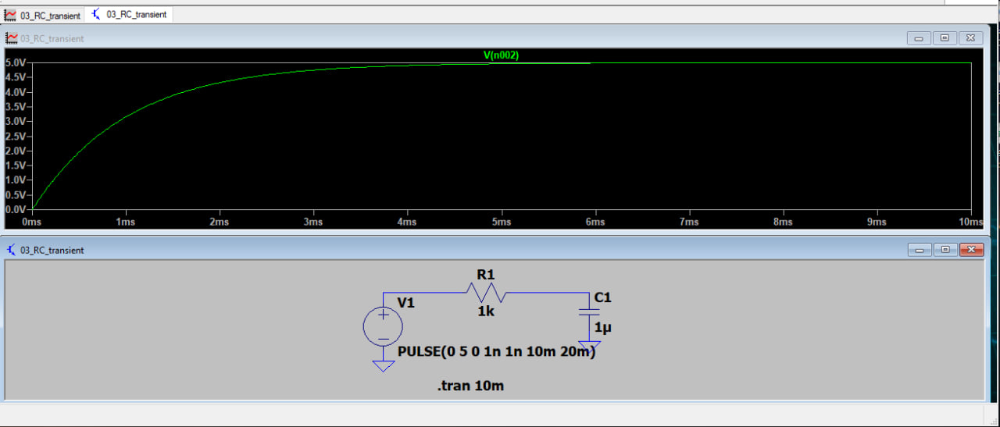
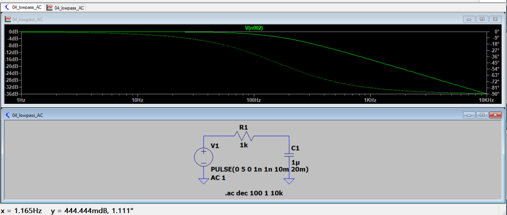
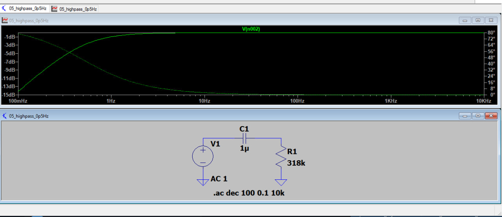
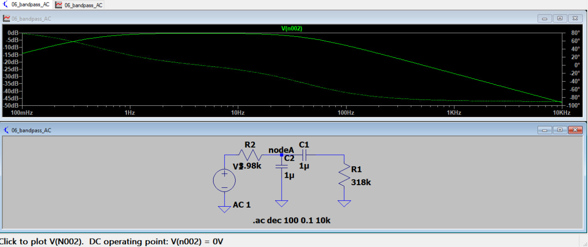
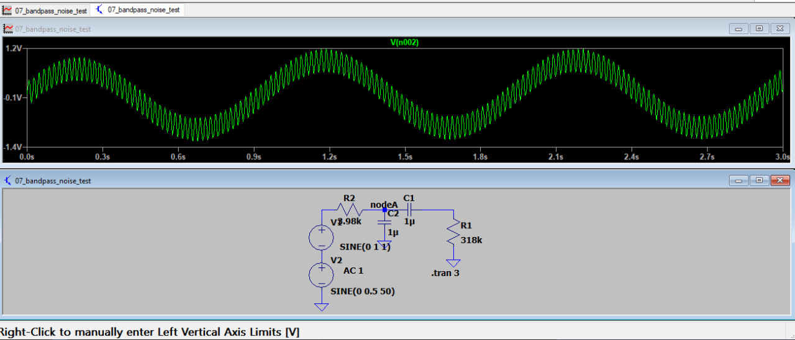
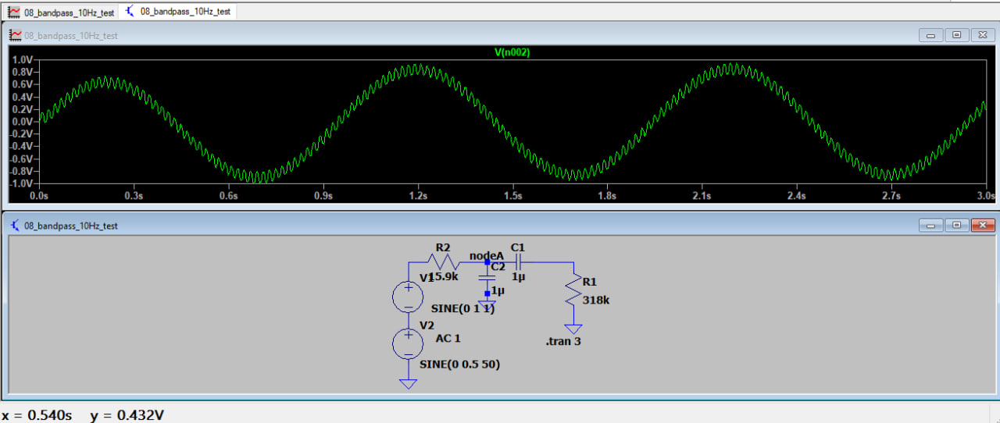

# ECG Analog Front-End Filter: LTspice Simulation

Design and verification of a passive RC band-pass filter for ECG signal
conditioning (0.5 to 40 Hz), built up from first principles in LTspice.

## 1. Objective and specification

| Parameter | Target |
|---|---|
| Passband | 0.5 Hz to 40 Hz (-3 dB points) |
| Passband flatness | within about 1 dB between 1 Hz and 10 Hz |
| Out-of-band rejection | attenuate 50 Hz mains interference |
| Topology | passive first-order RC low-pass + high-pass |

## 2. Method

Each building block was designed by hand, simulated, and compared with
the calculation before moving to the next stage.

| # | Circuit | Design equation |
|---|---|---|
| 01 | Series divider | V_out = V x R2 / (R1 + R2) |
| 02 | Parallel resistors | I_total = I1 + I2 (Kirchhoff's current law) |
| 03 | RC step response | tau = R x C |
| 04 | RC low-pass | fc = 1 / (2 pi R C) |
| 05 | RC high-pass | fc = 1 / (2 pi R C) |
| 06 | Band-pass (cascade) | low-pass fc = 40 Hz, high-pass fc = 0.5 Hz |
| 07, 08 | Noise rejection test | 1 Hz signal + 50 Hz interference |

## 3. Design values and verification

| Test | Calculated | Simulated |
|---|---|---|
| Series: midpoint voltage and current (10 V, 1k + 3k) | 7.5 V, 2.5 mA | 7.5 V, 2.5 mA |
| Parallel: I(R1), I(R2), I(source) (10 V, 1k and 3k) | 10, 3.33, 13.33 mA | 10, 3.33, 13.33 mA |
| RC step: voltage at t = tau (1k, 1 uF, 5 V step) | 3.16 V at 1 ms | about 3.2 V (read from plot) |

| Filter | Component values | Calculated cutoff |
|---|---|---|
| Low-pass (04) | 1k, 1 uF | 159 Hz |
| High-pass (05) | 318k, 1 uF | 0.50 Hz |
| Band-pass, low-pass stage (06) | 3.98k, 1 uF | 40 Hz |
| Band-pass, high-pass stage (06) | 318k, 1 uF | 0.50 Hz |
| Noise test, low-pass stage (07) | 3.98k, 1 uF | 40 Hz, about -4.1 dB at 50 Hz |
| Noise test, low-pass stage (08) | 15.9k, 1 uF | 10 Hz, about -14.2 dB at 50 Hz |

## 4. Simulation results

### 01 Series circuit


Series circuit with V1 = 10 V, R1 = 1k, R2 = 3k. The simulation gives 7.5 V at the midpoint and 2.5 mA, matching the voltage-divider calculation.

### 02 Parallel circuit


Parallel circuit with R1 = 1k and R2 = 3k. The branch currents (10 mA and 3.33 mA) sum to the 13.33 mA source current, confirming Kirchhoff's current law.

### 03 RC step response


RC charging circuit (R = 1k, C = 1 uF). The capacitor voltage rises exponentially toward 5 V with time constant tau = R x C = 1 ms, reaching about 63% (3.16 V) at t = 1 ms.

### 04 Low-pass filter


RC low-pass filter (1k, 1 uF). The gain is flat at 0 dB and falls above the cutoff frequency fc = 1/(2 pi R C), about 159 Hz, with the phase approaching -90 degrees.

### 05 High-pass filter


RC high-pass filter (1 uF, 318k) with cutoff fc of about 0.5 Hz. It blocks slow baseline drift and passes signals above about 1 Hz.

### 06 Band-pass filter


Band-pass filter built from a low-pass stage (3.98k, 1 uF, fc about 40 Hz) followed by a high-pass stage (1 uF, 318k, fc about 0.5 Hz). It passes roughly 0.5 to 40 Hz, a band typical of ECG monitoring (diagnostic ECG standards use a wider band, about 0.05 to 150 Hz).
### 07 Noise test, R2 = 3.98k


Transient test with a 1 Hz, 1 V "heartbeat" plus 50 Hz, 0.5 V "mains noise" through the band-pass filter (R2 = 3.98k, low-pass fc about 40 Hz). The 1 Hz signal passes, but the 50 Hz noise is reduced by only about 4 dB (calculated), because it lies close to the cutoff.

### 08 Noise test, R2 = 15.9k


Same test with R2 = 15.9k, which moves the low-pass cutoff to about 10 Hz. The 50 Hz noise is reduced by about 14 dB (calculated) and the ripple is much smaller. The trade-off is that fast ECG features above 10 Hz would also be attenuated.

## 5. Discussion

- The simulated results agree with the hand calculations in the
  verification table.
- The passband gain is slightly below 0 dB. At 1 Hz, the 0.5 Hz
  high-pass stage alone gives a gain of 0.89 (about -1 dB), and the peak
  of the 1 Hz test signal in the simulation is about 0.9 V.
- First-order stages roll off at only -20 dB/decade. The 50 Hz
  interference lies close to the 40 Hz cutoff, so it is attenuated by
  only about 4 dB. Lowering the low-pass cutoff to 10 Hz gives about
  14 dB, but it also attenuates ECG components above 10 Hz.
- The two stages interact slightly, because the second stage loads the
  first. With the 318k load on the 3.98k stage, the error is small
  (about 1%).

## 6. Limitations

- No gain: a real ECG (about 1 mV) needs an instrumentation amplifier
  and gain stages before filtering.
- First-order rolloff is not enough for 50 Hz rejection. A notch filter
  or a higher-order active filter is needed.
- Ideal components only: no tolerances, op-amp noise, input impedance,
  or patient-safety isolation (IEC 60601-1) are modelled.
- No Monte Carlo or temperature analysis of component tolerance.

## 7. Next steps

1. Add an op-amp buffer and gain stage, and a 2nd-order active filter.
2. Add a 50 Hz twin-T notch filter.
3. Run Monte Carlo analysis (1% resistors, 10% capacitors).
4. Done: digital filtering and R-peak detection on real MIT-BIH ECG data, see [ecg-rpeak-detection-python](https://github.com/henik21-code/ecg-rpeak-detection-python)

## 8. Repository structure

```
circuits/       LTspice .asc files (01 to 08)
screenshots/    simulation results
README.md
```

Tool: LTspice (Analog Devices). Open any `.asc` file and press Run.
